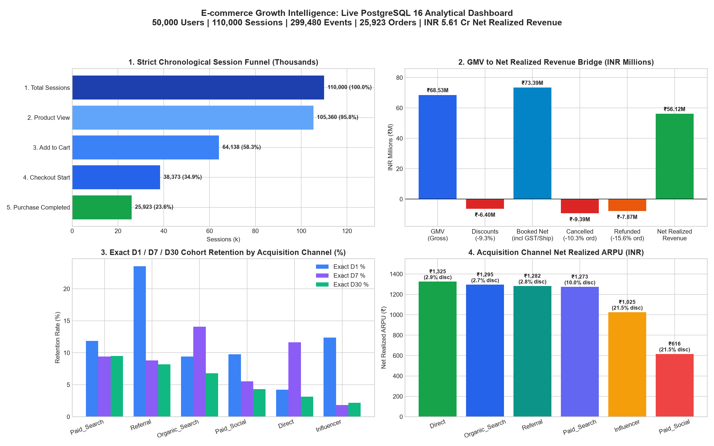
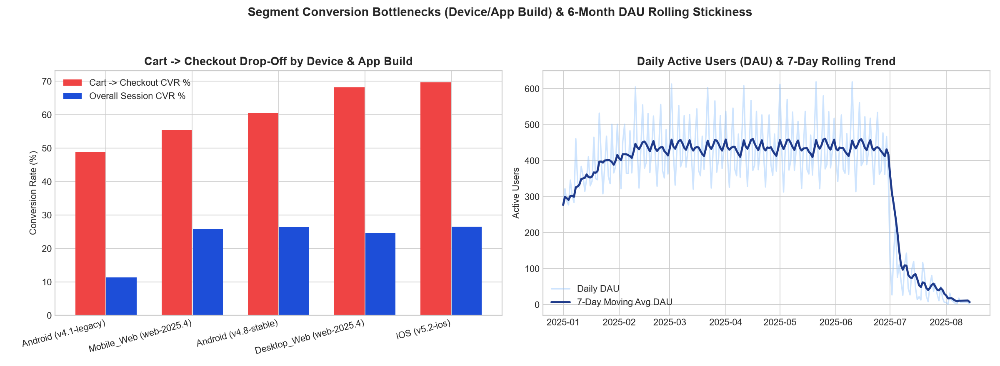

# E-commerce Growth Intelligence: Funnel, Retention & Revenue Analytics

A production-quality, SQL-first Product Analytics & Analytics Engineering portfolio project simulating growth, conversion funnel friction, cohort retention, and revenue leakage analytics for a large Indian e-commerce platform.

---

## Live Dashboard Captures (Generated from PostgreSQL 16)





---

## 1. Architecture & Repository Structure

```text
ecommerce-growth-intelligence/
├── .env.example                                  # Environment variables template (no secrets in Git)
├── .gitignore                                    # Ignores .env, .venv/, __pycache__/
├── docker-compose.yml                            # Reproducible PostgreSQL 16 container (Host Port 5433)
├── requirements.txt                              # Locked Python dependencies
├── pytest.ini                                    # Automated test suite configuration
├── README.md                                     # Setup, execution, screenshots, and verification guide
├── sql/
│   ├── schema.sql                                # Relational DDL with PK/FK/CHECK constraints
│   ├── 00_schema.sql                             # Identical numbered DDL entry point
│   ├── seed_data.sql                             # Deterministic seed script (50k users, 110k sessions, 299k events, 25.9k orders)
│   ├── 01_executive_kpis_and_reconciliation.sql  # Multi-table joins, FILTER aggregates, GMV-to-Net Revenue waterfall
│   ├── 02_strict_session_funnel.sql              # Strictly ordered session funnel vs naive funnel + stage conversion
│   ├── 03_funnel_segmentation_matrix.sql         # Device, City Tier, Channel, Category conversion gaps & rank
│   ├── 04_user_engagement_dau_wau_mau.sql        # DAU, WAU, MAU, stickiness ratios, 7-day moving averages, LAG growth
│   ├── 05_cohort_retention_d1_d7_d30.sql         # Explicit D1/D7/D14/D30 cohort retention (right-censoring guarded)
│   ├── 06_repeat_purchase_and_ltv_windows.sql    # ROW_NUMBER, LAG, LEAD inter-purchase intervals & LTV curves
│   ├── 07_channel_and_category_economics.sql     # Channel & category ARPU, AOV, Repeat Rate, Refund Rate
│   ├── 08_revenue_leakage_diagnostics.sql        # Coupon cannibalization, COD vs UPI cancellations, refund drivers
│   ├── 09_data_quality_and_reconciliation.sql    # 10 automated checks: duplicates, nulls, orphans, timestamps, math
│   ├── 10_indexes_and_explain_analyze.sql        # Strategic composite & covering indexes + ANALYZE
│   └── 11_explain_analyze_benchmarks.sql         # Standalone EXPLAIN (ANALYZE, BUFFERS) benchmark queries
├── src/
│   ├── __init__.py
│   ├── db.py                                     # PostgreSQL connection pool & SQL execution helpers
│   ├── generate_seed_data.py                     # Schema + deterministic seed runner & row-count validator
│   ├── analytics.py                              # Z-test, Chi-Square, Mann-Whitney U, Welch t-test, A/B power calculator
│   ├── export_dashboard_preview.py               # Generates HTML and high-DPI PNG dashboard captures from PostgreSQL
│   └── run_pipeline.py                           # End-to-end orchestrator + live EXPLAIN (ANALYZE, BUFFERS) benchmark
├── app/
│   └── streamlit_app.py                          # 5-page interactive Streamlit + Plotly analytical dashboard
├── tests/
│   ├── conftest.py                               # Database fixtures
│   ├── test_schema_and_volume.py                 # Verifies row count minimums (50k/100k/150k/25k/10k)
│   ├── test_data_quality_sql.py                  # Asserts all 10 SQL data quality checks pass with 0 violations
│   └── test_funnel_and_metrics.py                # 10 tests verifying all SQL queries, funnel monotonicity & stat engine
└── docs/
    ├── data_dictionary_and_metrics.md            # Schema dictionary & exact mathematical metric definitions
    ├── business_case_study.md                    # Problem, methodology, actual SQL findings, 3 recs, A/B test design
    ├── interview_guide.md                        # Line-by-line SQL walkthroughs + 15 Senior Product Analyst Q&As
    ├── dashboard_capture.html                    # Interactive Plotly HTML dashboard snapshot
    └── screenshots/                              # High-DPI PNG captures generated from live PostgreSQL data
```

---

## 2. Quickstart & Setup Instructions (Windows PowerShell)

### Prerequisites
- **Docker Desktop** running (PostgreSQL 16 runs in Docker mapped to `localhost:5433` so it never conflicts with any existing local Postgres on `5432`).
- **Python 3.11+**

### Step-by-Step Commands

```powershell
# 1. Navigate to project directory
Set-Location "C:\Users\jainy\.gemini\antigravity\scratch\ecommerce-growth-intelligence"

# 2. Copy environment configuration
Copy-Item .env.example .env -Force

# 3. Start PostgreSQL 16 container
docker compose up -d

# 4. Create and activate Python virtual environment
python -m venv .venv
.\.venv\Scripts\Activate.ps1
.\.venv\Scripts\pip.exe install -r requirements.txt

# 5. Build schema, seed deterministic dataset (SEED=42), run all SQL scripts & EXPLAIN ANALYZE
.\.venv\Scripts\python.exe -m src.run_pipeline

# 6. Export PNG/HTML dashboard captures and run the 12 automated pytest tests
.\.venv\Scripts\python.exe -m src.export_dashboard_preview
.\.venv\Scripts\pytest.exe -v

# 7. Launch the 5-page interactive Streamlit dashboard
.\.venv\Scripts\streamlit.exe run app/streamlit_app.py
```

---

## 3. Documentation Links
- [Data Dictionary & Metric Definitions](docs/data_dictionary_and_metrics.md)
- [Product Analytics Business Case Study](docs/business_case_study.md)
- [SQL Walkthrough & 15 Product Analyst Interview Questions](docs/interview_guide.md)
- [Interactive HTML Dashboard Capture](docs/dashboard_capture.html)
